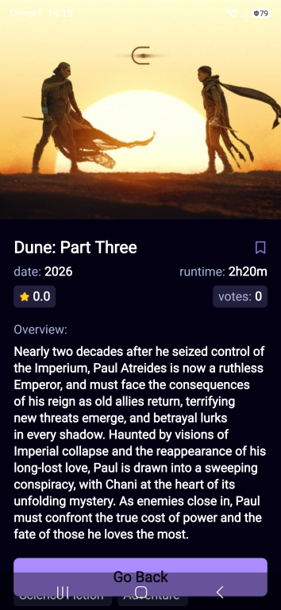

# MovieSearch

MovieSearch is a modern movie discovery app built with Expo and React Native. It lets users explore trending and latest films, search the TMDB catalog, open detailed movie pages, save favorites, and manage authentication and profile data through Appwrite.



## Features

- Browse trending movies and the latest releases
- Search movies by title
- View detailed information for each movie, including overview, genres, rating, runtime, budget, and revenue
- Save and remove movies from a personal watchlist
- Sign in, sign up, and manage user profile details
- Track popular searches in Appwrite-backed metrics
- Responsive mobile UI using Expo Router and NativeWind

## Tech Stack

- React Native + Expo
- TypeScript
- Expo Router
- NativeWind
- Appwrite for authentication and database storage
- TMDB API for movie data

## Project Structure

```text
.
├── app/                   # App screens and file-based routes
├── assets/                # Images, icons, fonts
├── components/            # Reusable UI components
├── constants/             # App configuration and constants
├── context/               # Authentication context
├── services/              # TMDB and Appwrite integrations
├── types/                 # Type declarations
├── app.json               # Expo app metadata
├── babel.config.js        # Babel config
├── tailwind.config.js     # Tailwind config
├── package.json           # Project scripts and dependencies
├── tsconfig.json          # TypeScript config
└── README.md
```

## Prerequisites

Before running the app, make sure you have:

- Node.js 18+ recommended
- npm or yarn
- Expo CLI
- An iOS simulator, Android emulator, or Expo Go on a phone
- A TMDB API key
- An Appwrite project with the required collections and environment variables

## Environment Variables

Create a `.env` file in the project root with the following values:

```env
EXPO_PUBLIC_MOVIE_BASE_URL=https://api.themoviedb.org/3
EXPO_PUBLIC_MOVIE_API_KEY=your_tmdb_api_key

EXPO_PUBLIC_APPWRITE_PROJECT_ID=your_appwrite_project_id
EXPO_PUBLIC_APPWRITE_DATABASE_ID=your_appwrite_database_id
EXPO_PUBLIC_APPWRITE_METRICS_ID=your_appwrite_metrics_collection_id
EXPO_PUBLIC_APPWRITE_MOVIE_ID=your_appwrite_saved_movies_collection_id
EXPO_PUBLIC_APPWRITE_USER_ID=your_appwrite_users_collection_id
EXPO_PUBLIC_APPWRITE_DELETE_ACCOUNT_FUNCTION_ID=your_appwrite_delete_function_id
```

## Appwrite Setup

This app uses Appwrite for:

- Email/password authentication
- User profile storage
- Saved movie records per user
- Search metrics/trending data

You will need to configure the project and create the collections/IDs referenced above. The app expects the following patterns:

- User collection: stores user profile data such as `accountId`, `name`, `email`, and `avatar`
- Saved movies collection: stores records keyed by `userId` and `movieId`
- Metrics collection: stores search and popularity data such as `searchTerm`, `title`, `movie_id`, `count`, and `poster_url`

## Installation

```bash
npm install
```

## Running the App

Start the Expo development server:

```bash
npx expo start
```

Then choose one of the available options:

- Run on Android emulator
- Run on iOS simulator
- Open in Expo Go on a physical device
- Launch the web version

Useful scripts:

```bash
npm run android
npm run ios
npm run web
npm run lint
```

## Notes

This product uses the TMDB API but is not endorsed or certified by TMDB.

## License

This project is for educational/demo purposes and may be used with the appropriate service credentials and licenses.
